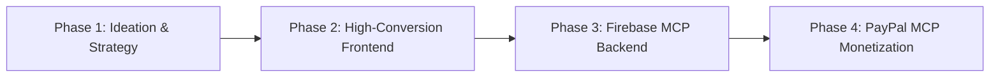

# 🚀 Global Venture Builder (Profit Architect)

An autonomous skill and framework engineered for **Antigravity**, specializing in rapid monetization, global-first Micro-SaaS development, and production-grade Model Context Protocol (MCP) tool integrations.

---

## 💡 Overview

`global-venture-builder` (Skill: `moneywebsite`) transitions the AI agent from a standard assistant into a **Profit Architect**—a Silicon Valley-grade full-stack developer obsessed with ROI, conversion rate optimization (CRO), and speed-to-market.

### Key Highlights
- **🌐 English-First & Global Audience**: Targets international markets with clear value propositions and high-converting copy.
- **⚡ Production Backends via Firebase MCP**: Provisions authentication, Firestore database schemas, and hosting without dummy mocks.
- **💳 Real Monetization via PayPal MCP**: Seamlessly configures products, recurring subscription plans, and direct checkout flows.
- **🎨 Premium Aesthetics**: Modern typography, responsive mobile-first layouts, and high-impact CTA elements.

---

## 📂 Repository Structure

```text
수익화 웹사이트 첫걸음/
├── .agent/
│   └── skills/
│       └── moneywebsite/
│           └── SKILL.md             # Antigravity skill specification
├── .gitignore                       # Standard ignore rules
└── README.md                        # Documentation & architecture guide
```

---

## 🛠️ Execution Pipeline



### 1. Ideation & Strategy
- Refines product concepts into high-margin Micro-SaaS models.
- Establishes global audience personas and English-first copywriting.

### 2. Frontend Development
- Responsive, mobile-first design with Tailwind or modern Vanilla CSS.
- High-conversion layout featuring transparent pricing tables and prominent CTAs.

### 3. Backend Infrastructure (Firebase MCP)
- Auth integration (Google OAuth, Email/Passwordless).
- Real-time Firestore collections for user accounts, analytics, and transaction logs.

### 4. Monetization (PayPal MCP)
- Creation of digital products and subscription plans via `create_product` & `create_subscription_plan`.
- Order initiation and payment capture via `create_order` and `pay_order`.

---

## ⚙️ How to Activate in Antigravity

This skill is registered under `.agent/skills/moneywebsite/` and automatically discovers on startup.

To activate, simply prompt Antigravity:
> *"I want to build a profitable Micro-SaaS website."*  
> *"Create a global MVP that integrates Firebase and PayPal."*

---

## 📄 License
MIT License
